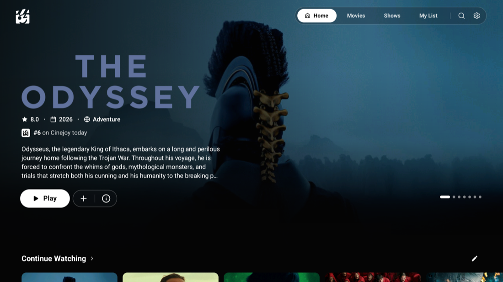
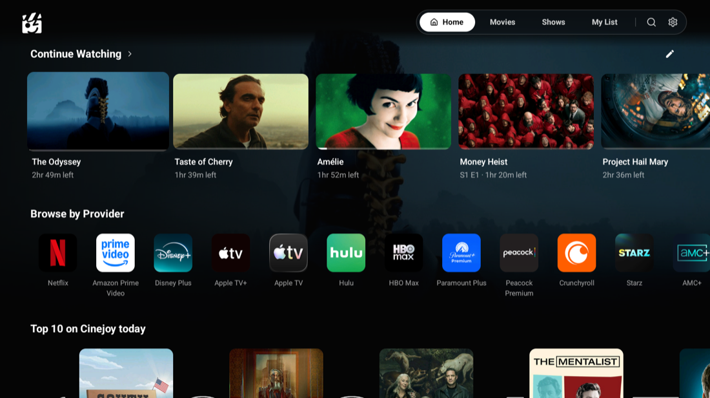
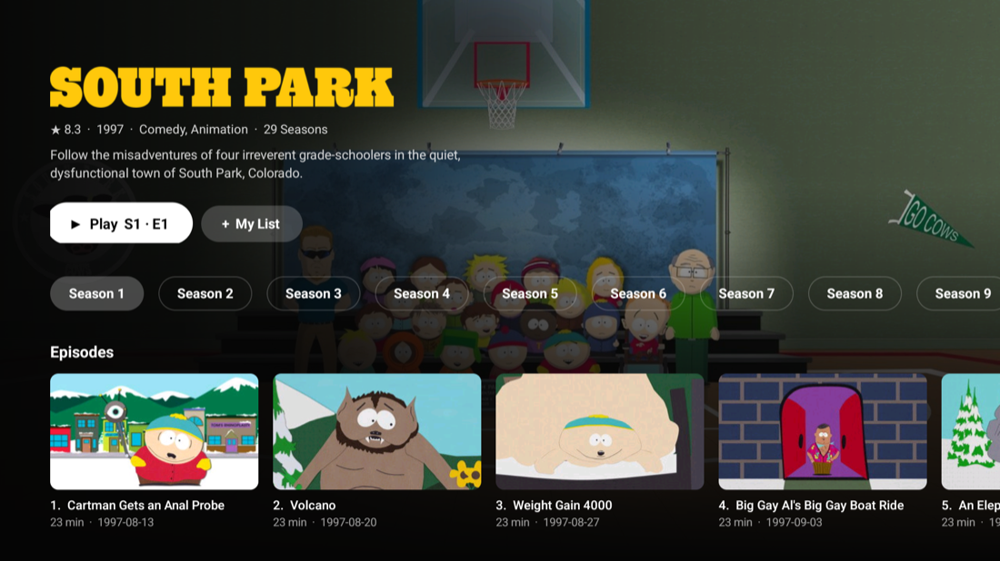
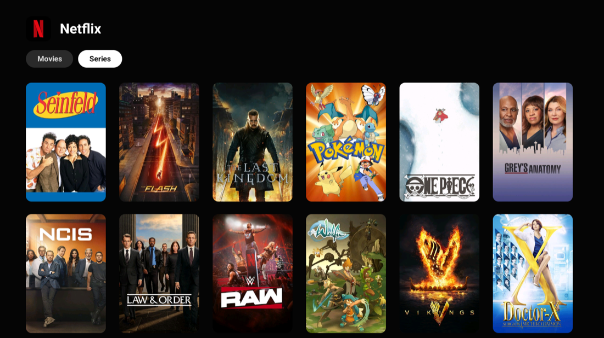
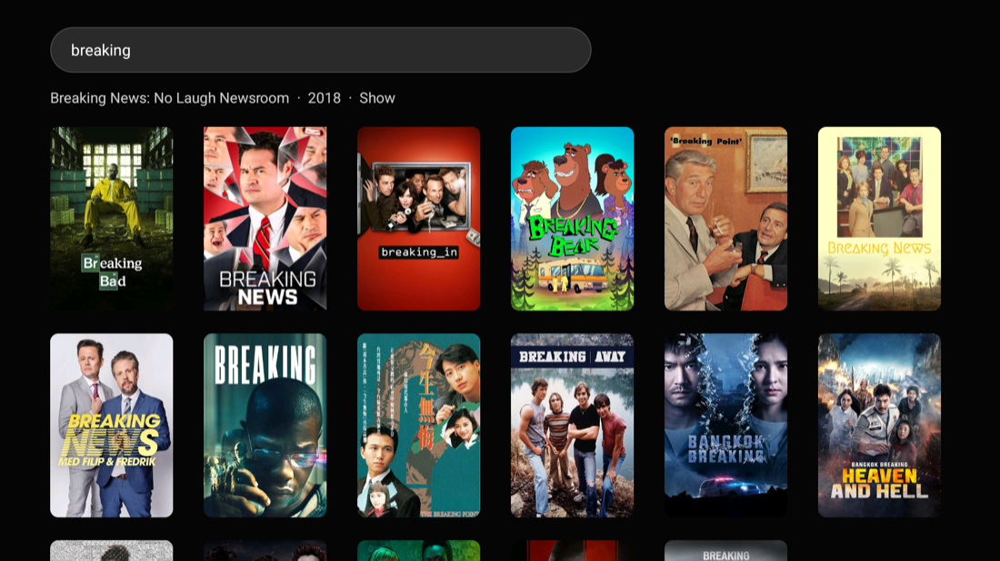
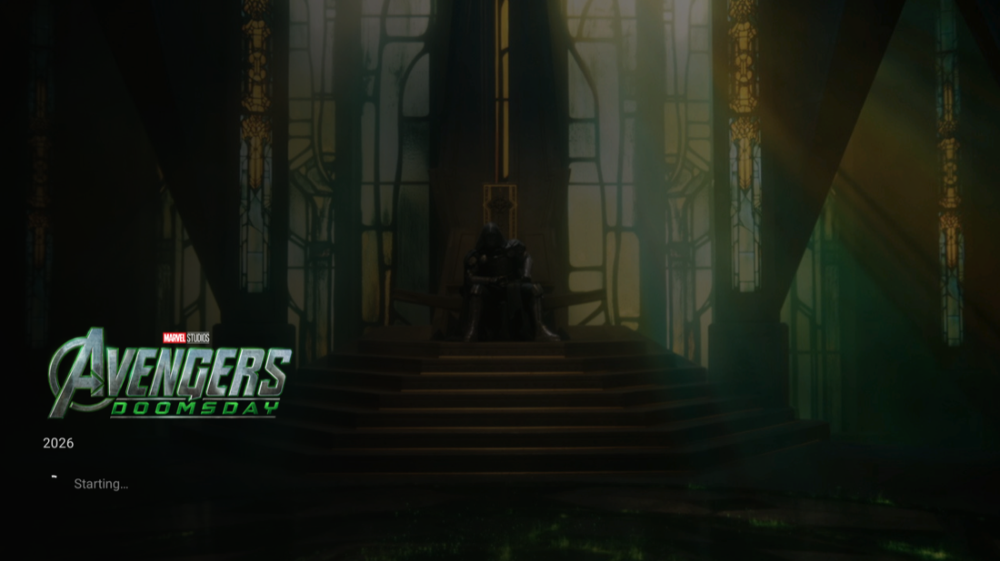

<div align="center">

# CleanWatch

**A fast, remote-friendly Android TV app for [cinejoy.pk](https://cinejoy.pk/)**

Native browsing screens that look like cinejoy's, cinejoy's own player for watching,
ads blocked, and subtitles that switch on in the right language.



</div>

---

## Why

cinejoy is a good-looking site, but on a TV it is a heavy web page: more than 9,000 elements,
35–40 frames per second while scrolling on a mid-range TV chip, and built for a mouse rather
than a remote. CleanWatch keeps what works (cinejoy's look, its player and its subtitles) and
replaces the rest:

- **Browsing is native.** Home, Movies, Shows, My List, search and details are drawn by the app
  itself, with cinejoy's layout, so the remote moves instantly.
- **Watching is cinejoy.** Play opens cinejoy's own player page, with the remote mapped to its
  controls. Films start in about 4–8 seconds, behind a loading screen with the film's picture.
- **Ads are blocked**, and pop-ups and redirects to other sites are refused.

| | |
|:---:|:---:|
|  |  |
| Continue Watching, Browse by Provider, Top 10 | Seasons and episodes |
|  |  |
| One service's films or series | Search as you type |

## Features

- **cinejoy's home page, natively.** Hero slides with the title's logo, rating, year, genre,
  "#N on Cinejoy today" and slide dots; then Continue Watching, Browse by Provider, Top 10 with
  big outlined numbers, Because you watched…, Trending, Movies and TV Series on Netflix,
  Top Rated, and cinejoy's themed lists, in cinejoy's order.
- **Continue Watching that matches cinejoy.** It reads cinejoy's own record of what was watched
  on the TV, with time left, season and episode, and a progress bar. Remove titles with the
  pencil.
- **17 streaming services.** Netflix, Prime Video, Disney+, Apple TV+, HBO Max and more, each
  with its own page of films and series.
- **Quick film start.** cinejoy is kept running in the background, so Play moves straight to the
  film instead of loading the whole site first: about 4–8 seconds instead of about 20.
- **Details pages** with seasons, episode pictures, Play / Resume, My List and similar titles.
- **Subtitles in your language.** English for English titles, French for French ones, Arabic
  for everything else, switched on automatically. Fix out-of-sync subtitles from the remote in
  0.5-second steps.
- **Ad blocking** for cinejoy's pages: about 3,600 ad and tracking hosts, pop-ups and
  off-site redirects refused, leftover ad boxes hidden.
- **Made for the remote.** Focus zoom and cinejoy's play overlay on posters, a hero you can flip
  with Left / Right, and a player you control with OK, arrows and Back.

## How it works

| Part | What it shows | Where the data comes from |
|---|---|---|
| **Home** | cinejoy's home layout (see above) | TMDB, cinejoy's Top 10 and lists, cinejoy's watch progress on the TV |
| **Movies, Shows** | The same hero, then popular, top-rated and genre rows | TMDB |
| **My List** | Titles added with +, and Continue Watching | Kept on the TV |
| **Provider** | One service's films or series, most popular first | TMDB (US catalogue, as on cinejoy) |
| **Details** | Picture, facts, Play, My List; seasons and episodes; similar titles | TMDB |
| **Search** | Results as you type, with the TV keyboard | TMDB |
| **Player** | cinejoy's player page (`/watch/movie/<id>`, `/watch/tv/<id>/<season>/<episode>`) | cinejoy |

These are the sources cinejoy's own pages use: film lists, posters and episodes come from TMDB,
and the Top 10 and themed lists from cinejoy's server at `wing.st`. Only the player is a web
page. The full cinejoy site is one press away: the gear in the header has
*Open the cinejoy website*.

### Why films start quickly

Opening cinejoy from nothing took the TV about 20 seconds before a film played: 3 s to set up a
browser view, then loading and running the site's code (about 90 script files) before the player
even asked for the video. Now:

1. **cinejoy waits in the background.** A few seconds after the start screen appears, the app
   loads a light cinejoy page (its player settings page) in a hidden browser view, has the
   player's code fetched in advance, and then pauses it.
2. **Play moves inside the running site.** The player screen takes that view and goes to the film
   the way a click on cinejoy's own link does, without reloading anything. Closing the player
   gives the view back, ready for the next film.
3. **A loading screen covers the wait.** The film's picture drifting slowly closer, its logo, and
   a spinner, until the film actually plays. If cinejoy shows a message instead (for example
   "This Hasn't Released Yet"), the loading screen steps aside so it can be read.

Measured on the Xiaomi TV: the first film after opening the app starts in about 6–12 seconds,
later ones in about 3–6. What is left is mostly cinejoy finding a server and the video
arriving, which depends on the network. Sometimes a source fails and cinejoy switches to
another ("Source failed. Trying …"), which takes longer; it does the same on the website.



### Why browsing is fast

- **Leanback grids.** Only the cards on screen exist, they are reused as you scroll, and the
  focused card stays in place while the row slides under it.
- **Pictures sized to the card.** Posters are decoded at card size in a compact format and
  cached in memory and on disk.
- **One background layer.** The large backdrop and its fades are drawn once and reused for
  every frame, without cross-fades.
- **Data kept in memory.** Each list is fetched once; going back to a screen is instant.

On a Xiaomi MiTV-MZTU0 (4-core MediaTek, Android 14), moving through the rows: half of the
frames take about 20 ms or less, 94% are on time, and the slowest 1% take under 50 ms.

## Getting started

### Requirements

- An Android TV or Google TV with Android 7.0 or newer.
- To build: a JDK (17 or newer) and the Android SDK with platform 36.
- A free **TMDB API Read Access Token**: create a TMDB account, then Settings → API.

### 1. Add your TMDB key

Put it in `local.properties` in the project folder. Git ignores this file, so the key never
ends up in the repository:

```properties
tmdb.token=eyJhbGciOi...
```

Without a key the rows stay empty; the player and the full website still work.

### 2. Build

```bash
tools/build.sh
```

This runs the unit tests and writes `dist/CleanWatch.apk`. The APK is signed with the debug
key: fine for sideloading, not for an app store. It contains your TMDB key, so don't share it.

### 3. Install on the TV

On the TV, open Settings → System → About and press OK on **Android TV OS build** seven times
(older TVs: Device Preferences → About → **Build**). Go back one level, open
**Developer options** and switch on **USB debugging**. Then, from your computer on the same
network (the TV's IP address is under Settings → Network):

```bash
tools/install.sh 192.168.1.50
```

Accept the "Allow USB debugging?" prompt on the TV the first time. Or copy
`dist/CleanWatch.apk` to a USB stick and open it with a file manager on the TV. CleanWatch then
appears in the TV's app row.

## Using the remote

**On the app's screens:** arrows move between cards, buttons and tabs, **OK** opens or plays,
and **Back** goes back. From deep in a list it first jumps to the top, then to the tabs; press it
twice on Home to exit.

- **Hero:** Left on Play and Right on the info button change slides; they also change by
  themselves every 9 seconds.
- **Continue Watching:** OK resumes where you stopped. To remove titles, press Up from the row
  to reach the pencil, press OK, then OK on each title (Back when done). Holding OK on a title
  also removes it.
- **Header:** the magnifier opens search; the gear has *Open the cinejoy website* and *Exit*.

**In cinejoy's player:**

| Button | What it does |
|---|---|
| **OK** | Play / pause. |
| **Left / Right** | Skip back / forward 10 seconds. Hold to keep skipping. |
| **Up / Down** | Show the player's buttons and select one (subtitles, servers, settings…). |
| **Back** | Close a pop-up menu or the player's buttons; otherwise return to CleanWatch. |
| **Hold Back** (or Menu) | Options: subtitle timing, pointer mode, page size, screen margin, lighter effects, green outline, reload, exit. |
| **Play/Pause, Rewind, Fast-forward** | Work if the remote has them (±30 seconds). |

On cinejoy's pages the arrows move an invisible mouse from link to link, so the site shows its
own hover effects. **Pointer mode** (in the options) shows a pointer you steer with the arrows,
for anything the normal selection can't reach.

## Subtitles


**Language.** Subtitles switch on by themselves, chosen by the title's original language:

| Original language | Subtitles |
|---|---|
| English | English |
| French | French |
| Anything else | Arabic |

Once the film plays, the app picks that language in the player's own subtitle menu (for a
language with many files, the first one in cinejoy's list). If cinejoy is started fresh rather
than from the background page, its "subtitles on start" setting does the same. If a title has no
subtitles in that language, none show; pick another from the player's subtitle button.

**Timing.** cinejoy offers many subtitle files per language, cut from different releases of
the video, so some run early or late. In the player, hold Back and choose
**Subtitles later (+0.5 s)** or **Subtitles sooner (−0.5 s)**. The menu stays open so you can
press again, and a message shows the current delay. **Reset subtitle timing** returns to 0. The
delay lasts for the current video.

cinejoy's "Sync subtitle to audio" works in a computer browser but never finished on the TV it
was tested on, so the app doesn't use it.

## Ad blocking

1. **Requests.** Every request cinejoy's pages, frames or service worker make is checked
   against a host list; a match gets an empty reply. The lists are
   [blocklist.txt](app/src/main/assets/blocklist.txt) (edit this one) and `blocklist-pgl.txt`,
   [Peter Lowe's list](https://pgl.yoyo.org/adservers/) of about 3,500 ad and tracking hosts.
   `tools/update-blocklist.sh` refreshes it.
2. **Redirects and pop-ups.** Pages can only navigate to the hosts in `ALLOWED_HOSTS`
   ([app/build.gradle](app/build.gradle)). Pop-up windows, redirects to other sites and
   `intent://` links are refused.
3. **Leftover boxes.** Common ad containers are hidden with CSS (the `HIDE` list in
   [cleanwatch.js](app/src/main/assets/cleanwatch.js)).

The app's own screens only talk to TMDB, TMDB's image server and cinejoy's list server.

When this was built (November 2026) cinejoy showed an "Ads are disabled for now" notice and
loaded no ad hosts. The blocking has been checked against known ad hosts and pop-ups, not
against cinejoy's own ads. If ads come back from a host that isn't listed, add the host to
`blocklist.txt` and rebuild. To watch what gets blocked:

```bash
adb logcat -s CleanWatch
```

## Project layout

| Path | What it is |
|---|---|
| `app/src/main/java/tv/cleanwatch/BrowseActivity.java` | The start screen: header, tabs and rows. |
| `app/src/main/java/tv/cleanwatch/Hero.java` | The hero slides and the backdrop behind the screen. |
| `app/src/main/java/tv/cleanwatch/Rows.java`, `Cards.java` | Rows; posters, Continue Watching cards, provider tiles, episodes. |
| `app/src/main/java/tv/cleanwatch/DetailsActivity.java`, `Billboard.java` | Details with seasons and episodes. |
| `app/src/main/java/tv/cleanwatch/SearchActivity.java`, `ProviderActivity.java` | Search; one streaming service's titles. |
| `app/src/main/java/tv/cleanwatch/Api.java` | TMDB and cinejoy's lists, with an in-memory cache. |
| `app/src/main/java/tv/cleanwatch/Progress.java`, `Store.java` | Continue Watching (from cinejoy) and My List. |
| `app/src/main/java/tv/cleanwatch/MainActivity.java`, `Loading.java` | cinejoy's pages: request filter, remote keys, options menu; the loading screen. |
| `app/src/main/java/tv/cleanwatch/Web.java` | The browser view kept running in the background between films. |
| `app/src/main/assets/cleanwatch.js` | Runs inside cinejoy's pages: selection, player controls, subtitles, ad hiding. |
| `app/src/main/java/tv/cleanwatch/AdBlocker.java`, `assets/blocklist*.txt` | Blocked hosts and their matching. |
| `tools/` | Build, install, blocklist update, banner image. |

## Tested on

- **Xiaomi MiTV-MZTU0** (Android 14, WebView 157): browsing, details, search, provider pages,
  playing films and episodes, subtitle language and timing, Continue Watching, and film start
  times with the background page (five titles in a row, each with the right subtitles).
- **Emulated 1080p Android TV** (Android 14, WebView 113): the player controls in full.

## Notes

- CleanWatch is an unofficial, personal project. It is not affiliated with or endorsed by
  cinejoy. cinejoy's name and logo belong to cinejoy.
- This product uses the TMDB API but is not endorsed or certified by TMDB.
- The Top 10 and themed lists come from cinejoy's own server, which isn't a public service. If
  it changes, those rows disappear; everything else keeps working.
- Not carried over from cinejoy's home page: its "Award Winning" rows, the provider picker
  beside "Movies on" (the rows use Netflix, cinejoy's default) and its per-genre icons.
